# SE Primer — Sistem ve Ürün Spesifikasyonu (spec.md)

**Ders:** YZM301 — Yazılım Mühendisliği  
**Proje Adı:** SE Primer (Yazılım Mühendisliği Kriz Simülasyonu & Kişiselleştirilmiş AI Tutor)  
**Tarih:** Ekim 2026  
**Sürüm:** 1.0.0  
**Yazarlar:** SE Primer Mühendislik & Ürün Ekibi  
**Referans Doküman:** `SE Primer — Ödev.pdf`

---

## 1. Problem Tanımı

Geleneksel yazılım mühendisliği eğitimi genellikle teorik slaytlar, izole kodlama ödevleri ve yapay sınav soruları üzerinden yürütülmektedir. Ancak gerçek dünyada yazılım mühendisleri; baskı altında mimari kararlar alma, geri alma (rollback) stratejileri belirleme, test kapsamı ile zaman kısıtı arasındaki ödünleşimleri (trade-offs) yönetme ve KVKK / veri gizliliği gibi yasal/etik sorumlulukları gözetme durumunda kalırlar.

Junior veya orta seviye mühendisler, bir üretim (production) krizinde doğrudan doğru cevabı bilmekten ziyade; “Hangi veritabanı şeması etkilendi?”, “Kısa duman testi (smoke test) çalıştırmak ne kadar vakit kaybettirir?”, “Log kayıtlarındaki hassas kişisel veriler (PII) nasıl anonimleştirilir?” gibi sorularla düşünmeyi öğrenmeye ihtiyaç duyarlar.

**SE Primer**, bu açığı kapatmak amacıyla kurgulanmış; kullanıcı kararlarının teknik, operasyonel ve etik sonuçlarını anında gösteren, Sokratik tarzda yönlendirici sorular soran bir AI Tutor ile donatılmış, mobil uyumlu ve oyunlaştırılmış bir kriz simülasyonudur.

---

## 2. Hedef Kullanıcılar ve Ürünün Amacı

### 2.1 Hedef Kullanıcı Profilleri (Persona'lar)
1. **Yeni Başlayan (Junior / Stajyer Mühendis):** Yazılım mühendisliği temel kavramlarını öğrenmekte olan, kriz anında hangi adımları izleyeceğini kestiremeyen ve kavramsal ipuçlarına yoğun biçimde ihtiyaç duyan öğrenciler.
2. **Orta Seviye (Mid-Level Mühendis):** Mimari kararları ve test süreçlerini bilen, ancak kriz anlarında kritik detayları (örneğin veritabanı şema uyumsuzluğu veya loglardaki PII sızıntısı) gözden kaçırabilen, ipucunu talep ettiğinde görmek isteyen geliştiriciler.
3. **Deneyimli Mühendis (Senior / Tech Lead / SRE):** Hızlı karar alma reflekslerine sahip, zaman baskısı altında doğru mühendislik dengelerini kurabilen ve stres altında 60 saniyelik sayaçla kendini sınayan mühendisler.

### 2.2 Ürünün Amacı
Kullanıcıya tek bir gerçekçi kriz anı yaşatarak (“08:00, randevu sistemi çöktü. 300 hasta bekliyor.”) üç ardışık mühendislik kararında (Mimari & Rollback, Test & Dağıtım, KVKK & Log Paylaşımı) sorumluluk aldırmak; doğru cevabı doğrudan söylemeyen AI Tutor ile analitik düşünmeyi geliştirmek ve kararların kümülatif sonucuna göre iki belirgin sondan birine ulaştırmaktır.

---

## 3. Kullanıcı İhtiyaçları

- **N-01:** Kullanıcı, kendi deneyim seviyesine (Yeni Başladım / Orta Seviyedeyim / Deneyimliyim), rolüne (Yazılım Geliştirici / Test Mühendisi / Sistem & DevOps Mühendisi) ve öğrenme hedefine (Teknik Kararlar / Test ve Kalite / Güvenlik ve Gizlilik) uygun bir deneyim yaşamalıdır.
- **N-02:** Kullanıcı, her karar aşamasında teknik bağlamı net bir dille kavramalıdır.
- **N-03:** Yeni başlayan kullanıcılar aşırı bunalmadan otomatik ipucu alabilmeli, deneyimli kullanıcılar ise gerçek hayat kriz hissini 60 saniyelik zaman baskısıyla deneyimlemelidir.
- **N-04:** Kullanıcı bir seçim yaptığında, salt puan veya soyut bir mesaj yerine “Ne oldu?” ve “Neden oldu?” teknik gerekçesini görmelidir.
- **N-05:** Kullanıcı takıldığında veya merak ettiğinde AI Tutor ile etkileşime girebilmeli; ancak Tutor cevabı fısıldamak yerine kullanıcının zihnini açan Sokratik sorular sormalıdır.
- **N-06:** Kullanıcı simülasyonu dilediğinde sıfırlayabilmeli ve farklı kararların sonuçlarını keşfedebilmelidir.

---

## 4. Fonksiyonel Gereksinimler

- **FR-01 (Kişiselleştirme Formu):** Uygulama açılışta kullanıcıdan üç zorunlu seçim almalıdır:
  1. *Deneyim Seviyesi:* `junior` (Yeni başladım), `mid` (Orta seviyedeyim), `senior` (Deneyimliyim).
  2. *Rol:* `developer` (Yazılım geliştirici), `qa` (Test mühendisi), `devops` (Sistem / DevOps mühendisi).
  3. *Öğrenme Hedefi:* `technical` (Teknik kararlar), `testing` (Test ve kalite), `security` (Güvenlik ve gizlilik).
- **FR-02 (Dinamik Anlatı Uyarlaması):** Seçilen rol ve hedef, kriz anlatımındaki operasyonel vurguları ve AI Tutor'ın geri bildirim üslubunu özelleştirmelidir.
- **FR-03 (Seviyeye Göre İpucu ve Süre Davranışı):**
  - `junior`: Her kararda ipucu paneli otomatik olarak açık gelir.
  - `mid`: İpucu paneli gizlidir; kullanıcı "İpucu İste" butonuna bastığında açılır.
  - `senior`: Her karar aşaması için 60 saniyelik geri sayım sayacı çalışır.
- **FR-04 (60 Saniye Zaman Aşımı Kuralı):** Deneyimli modda 60 saniye dolduğunda kriz paniği simüle edilir; varsayılan olarak zaman aşımı güvenli/otomatik karara zorlanır veya kriz operasyonunda gecikme cezası uygulanarak bir sonraki adıma kontrollü biçimde geçilir. Oyun donmaz, kilitlenmez ve kullanıcı arayüzü geçersiz çoklu tıklamalara karşı korunur.
- **FR-05 (Karar 1 — Mimari & Rollback Stratejisi):**
  - Seçenek A: Eski sürüme geri dön (Rollback). *Sonuç: Güvenli yol, ancak veritabanı şema migrasyon kontrolü zorunluluğu teknik gerekçede açıklanır.*
  - Seçenek B: Canlıda doğrudan yama uygula (Hotfix on Production). *Sonuç: Yüksek risk, potansiyel veri bozulması ve tahmin edilemeyen yan etkiler açıklanır.*
- **FR-06 (Karar 2 — Test & Yayın Güvenliği):**
  - Seçenek A: Önce kısa ama kritik testleri (Smoke/Sanity) çalıştır (10-15 dk gecikme). *Sonuç: Regresyon riski düşer, servis güvenle ayağa kalkar.*
  - Seçenek B: Testleri atlayıp hemen yayına al. *Sonuç: Zaman kazanılır gibi görünür ancak gizli bug riski katlanır.*
- **FR-07 (Karar 3 — KVKK & Veri Gizliliği):**
  - Log dosyasında `Ahmet Yılmaz - TC: 12345678901 - Teşhis: Akut Pankreatit` kurgusal verisi bulunur.
  - Seçenek A: Kişisel veriyi maskeleyerek (PII Masking / Pseudonymization) güvenli biçimde paylaş. *Sonuç: KVKK m.4 ve m.12 uyumu sağlanır.*
  - Seçenek B: Logu hiçbir değişiklik yapmadan Slack/Teams genel kanalına at. *Sonuç: Açık KVKK ihlali, idari para cezası ve itibar kaybı.*
- **FR-08 (Sonuç Motoru ve İki Belirgin Son):**
  - Kararların birleşimi deterministik durum makinesiyle hesaplanır.
  - **Son A (Başarılı Kriz Yönetimi):** `08:25 Sistem ayakta, veriler korundu, KVKK ihlali yaşanmadı.` (Rollback + Kısa Test + Maskeleme kombinasyonu veya güvenli hibrit).
  - **Son B (Olumsuz Sonuç / Ağır Risk):** `Sistem kısmen çalışsa bile KVKK ihlali veya canlıda yama/testsiz yayın nedeniyle operasyonel felaket yaşandı.` (Hotfix, testsiz yayın veya maskesiz paylaşım durumlarında).
- **FR-09 (Neden-Sonuç Paneli):** Her seçimden hemen sonra ve final ekranında 3 kararın tamamı için:
  - Yapılan seçim,
  - Oluşan durum ("Ne oldu?"),
  - Teknik gerekçe ("Neden oldu?") kartlar halinde gösterilir.
- **FR-10 (Sokratik AI Tutor):**
  - Kullanıcı karar vermeden önce veya karar sırasında AI Tutor'a soru sorabilir veya düşüncesini yazabilir.
  - Tutor doğrudan "A'yı seç" demez; Sokratik soru, hafif ipucu ve geri bildirim üretir.
  - Yanıt şeması: `{ question, hint, feedback, reveals_answer }`.
  - Gerçek Gemini API / Google AI Studio anahtarı varsa canlı çağrı yapılır; anahtar yoksa veya çevrimdışıysa kural tabanlı deterministik yedek mod devreye girer ve UI'da yedek modda olduğu şeffafça belirtilir.
- **FR-11 (Yeniden Başlatma):** Kullanıcı "Simülasyonu Yeniden Başlat" dediğinde tüm seçimler, sayaçlar, loglar ve oyun durumu bellekten temizlenir, Ekran 1'e dönülür.
- **FR-12 (Çift Tıklama Koruması):** Karar butonlarına peş peşe basıldığında yarış durumu (race condition) oluşmaz; ilk tıklamayla butonlar kilitlenir.

---

## 5. Fonksiyonel Olmayan Gereksinimler

- **NFR-01 (Mobil Öncelikli & Duyarlı Tasarım):** Arayüz 360px - 430px genişlikteki akıllı telefon ekranlarında tek bir piksel bile yatay kaydırma (horizontal scroll) olmaksızın kusursuz çalışmalıdır. Masaüstü ekranlarda ise merkezi kompakt bir mobil kart simülatörü görünümü sunmalıdır.
- **NFR-02 (Performans & Tepki Süresi):** Karar geçişleri ve yerel durum güncellemeleri 50 ms altında gerçekleşmelidir. AI Tutor isteklerinde görsel yükleniyor (skeleton/spinner) göstergesi sunulmalıdır.
- **NFR-03 (Erişilebilirlik - a11y):** WCAG 2.1 AA kontrast standartlarına uyulmalı, tüm buton ve form elemanları görünür odak halkalarına (`focus-visible`) ve semantik HTML etiketlerine (`aria-label`, `role`) sahip olmalıdır.
- **NFR-04 (Güvenlik & Gizlilik):** Uygulama hiçbir gerçek kişi verisi içermez. API anahtarları asla istemci kaynak koduna hardcode edilmez; `.env` veya kullanıcı oturum girdisi üzerinden yönetilir.
- **NFR-05 (Test Edilebilirlik):** Tüm etkileşimli bileşenler Cypress testlerinde kolay ve kararlı seçim için `data-cy` nitelikleriyle donatılmalıdır.

---

## 6. Kapsam İçi Özellikler

1. Tek bir kurgusal sağlık randevu krizi senaryosu.
2. 3 aşamalı kişiselleştirme anketi (Seviye, Rol, Hedef).
3. 3 ardışık teknik karar aşaması (Mimari, Test, KVKK).
4. Seviyeye özgü dinamik davranışlar (Junior: otomatik ipucu, Mid: istek üzerine ipucu, Senior: 60s sayaç).
5. Deterministik kurallara dayanan 2 farklı son (Son A: Başarılı, Son B: Olumsuz/KVKK İhlali).
6. Karar sonrası "Ne oldu? Neden oldu?" gerekçelendirme kartları.
7. Sokratik soru üreten ve cevabı ele vermeyen AI Tutor mimarisi (canlı Gemini entegrasyonu + çevrimdışı dayanıklı mod).
8. 20 örneklik etiketlenmiş AI Tutor değerlendirme veri seti (`eval/`).
9. Uçtan uca Cypress test paketi ve test koşu raporu.
10. 60 saniyelik YouTube demo video senaryosu ve Türkçe metni.

---

## 7. Kapsam Dışı Özellikler (Yapılmayan 3+ Özellik ve Gerekçeleri)

Aşağıdaki özellikler ödev dokümanı (`SE Primer — Ödev.pdf`) gereğince bilinçli olarak kapsam dışı bırakılmıştır:
1. **Kullanıcı Hesabı ve Kimlik Doğrulama (Auth/Login):** Tek oturumluk ve anında oynanabilir bir eğitim simülasyonu hedeflendiği için gereksiz sürtünme oluşturmamak adına kapsam dışıdır.
2. **İkinci Bölüm / Çoklu Senaryolar:** Projenin pedagojik derinliğini tek bir kriz (hastane randevu sistemi) üzerinde en yüksek kalitede yoğunlaştırmak amacıyla ikinci bir senaryo geliştirilmemiştir.
3. **Gerçek Hasta Verisi ve Canlı Sağlık Sistemi Entegrasyonu:** KVKK ve etik ilkelere tam uyum sağlamak, hasta mahremiyeti riski yaratmamak amacıyla tamamen kurgusal/mock veriler kullanılmıştır.
4. **Native Mobil Uygulama (iOS/Android IPA/APK):** Tarayıcı tabanlı mobil öncelikli Web App (PWA uyumlu) geliştirilerek her cihazdan anında erişim sağlanması hedeflenmiştir.

---

## 8. Kullanıcı Akışı (User Flow)

```
[EKRAN 1: Kişiselleştirme]
   ├── Seviye Seçimi (Junior / Mid / Senior)
   ├── Rol Seçimi (Geliştirici / Testçi / DevOps)
   └── Hedef Seçimi (Teknik / Test / Güvenlik)
            │
            ▼ "Krize Müdahale Et" Butonu
[EKRAN 2: Kriz Sahnesi & Karar Döngüsü]
   ├── Kriz Bağlamı: "08:00, randevu sistemi çöktü. 300 hasta bekliyor..."
   │
   ├── [AŞAMA 1 - MİMARİ]
   │     ├── Senior ise: 60s Sayaç Başlar
   │     ├── Junior ise: İpucu açık / Mid ise: "İpucu İste"
   │     ├── AI Tutor: Kullanıcı soru sorabilir, Sokratik yönlendirme alır
   │     ├── Seçim Yapılır: [A) Geri Dön] veya [B) Canlıda Yama]
   │     └── Sonuç Paneli: Ne oldu? Neden oldu? ("Devam Et")
   │
   ├── [AŞAMA 2 - TEST]
   │     ├── Senior ise: 60s Sayaç Başlar
   │     ├── AI Tutor etkileşimi
   │     ├── Seçim Yapılır: [A) Kısa Test Koş] veya [B) Hemen Yayına Al]
   │     └── Sonuç Paneli: Ne oldu? Neden oldu? ("Devam Et")
   │
   └── [AŞAMA 3 - KVKK]
         ├── Log İncelemesi: PII Uyarısı
         ├── AI Tutor etkileşimi
         ├── Seçim Yapılır: [A) Maskele] veya [B) Ekibe Olduğu Gibi At]
         └── Sonuç Paneli: Ne oldu? Neden oldu? ("Sonuçları Gör")
            │
            ▼
[EKRAN 3: Sonuç ve Değerlendirme]
   ├── Nihai Durum:
   │     ├── SON A: 08:25 Sistem Ayakta, Veri Güvende (Başarılı)
   │     └── SON B: Sistem Ayakta ama KVKK İhlali / Ağır Operasyonel Risk (Kötü)
   ├── 3 Kararın Karşılaştırmalı Özeti & Teknik Analiz Tablosu
   └── "Simülasyonu Yeniden Başlat" Butonu (Ekran 1'e döner)
```

---

## 9. Durum Makinesi ve Akış Şeması (State Machine)

Aşağıdaki Mermaid şeması uygulamanın durumlarını (`AppStatus`), geçiş tetikleyicilerini ve karar dallanmalarını göstermektedir:

```mermaid
stateDiagram-v2
    [*] --> Onboarding: Uygulama Başlatıldı

    state Onboarding {
        [*] --> SelectExperience
        SelectExperience --> SelectRole
        SelectRole --> SelectGoal
        SelectGoal --> ReadyToStart
    }

    Onboarding --> Decision1_Arch: "Krize Müdahale Et" [Valid Form]

    state Decision1_Arch {
        [*] --> Timer1_Running: Senior ise 60s Başlat
        Timer1_Running --> Timeout1: Süre Bitti (60s)
        Timer1_Running --> Choice1_Made: Seçenek A (Rollback) veya B (Hotfix)
        Timeout1 --> Choice1_Made: Varsayılan Güvenli Seçim / Zaman Cezası
    }

    Decision1_Arch --> Outcome1_Review: Karar 1 Verildi
    Outcome1_Review --> Decision2_Test: "Sonraki Adıma Geç"

    state Decision2_Test {
        [*] --> Timer2_Running: Senior ise 60s Başlat
        Timer2_Running --> Timeout2: Süre Bitti (60s)
        Timer2_Running --> Choice2_Made: Seçenek A (Smoke Test) veya B (Skip Test)
        Timeout2 --> Choice2_Made: Varsayılan Güvenli Seçim / Zaman Cezası
    }

    Decision2_Test --> Outcome2_Review: Karar 2 Verildi
    Outcome2_Review --> Decision3_Privacy: "Sonraki Adıma Geç"

    state Decision3_Privacy {
        [*] --> Timer3_Running: Senior ise 60s Başlat
        Timer3_Running --> Timeout3: Süre Bitti (60s)
        Timer3_Running --> Choice3_Made: Seçenek A (Maskele) veya B (Ham Gönder)
        Timeout3 --> Choice3_Made: Varsayılan Güvenli Seçim / Zaman Cezası
    }

    Decision3_Privacy --> Outcome3_Review: Karar 3 Verildi
    Outcome3_Review --> FinalResult: "Sonuç Ekranını Gör"

    state FinalResult {
        [*] --> EvaluateOutcomes
        EvaluateOutcomes --> Outcome_A: Karar 1=A AND Karar 2=A AND Karar 3=A
        EvaluateOutcomes --> Outcome_B: Karar 3=B OR (Karar 1=B AND Karar 2=B)
    }

    FinalResult --> Onboarding: "Yeniden Başlat" [State Reset]
```



---

## 10. Somut ve Doğrulanabilir Kabul Örnekleri (Given / When / Then)

### Kabul Örneği 1: Yeni Başlayan Kullanıcıya Otomatik İpucu Gösterilmesi
- **Given:** Kullanıcı onboarding ekranında deneyim seviyesini “Yeni başladım” (`junior`) olarak seçmiş ve kriz senaryosunu başlatmıştır.
- **When:** Karar 1 (Mimari & Rollback) ekranı ilk kez yüklendiğinde,
- **Then:** Herhangi bir butona basılmasına gerek kalmaksızın ipucu kartı doğrudan görünür (`visible`) olmalıdır ve veritabanı şema uyumluluğuna dair açıklayıcı rehber metin içermelidir.

### Kabul Örneği 2: Deneyimli Kullanıcı İçin 60 Saniyelik Karar Sayacı ve Zaman Aşımı
- **Given:** Kullanıcı onboarding ekranında deneyim seviyesini “Deneyimliyim” (`senior`) olarak seçmiş ve Karar 2 (Test & Dağıtım) aşamasına geçmiştir.
- **When:** Ekran açıldığı anda 60 saniyelik sayaç `60` değerinden geriye doğru saymaya başlar ve kullanıcı 60 saniye boyunca seçim yapmazsa,
- **Then:** Süre `0` olduğunda sistem kilitlenmez; zaman aşımı uyarısı tetiklenir, güvenli varsayılan karar (veya gecikme cezası) uygulanarak sonuç kartı görüntülenir ve çoklu tıklamalar engellenir.

### Kabul Örneği 3: Her Seçimden Sonra Kararın Teknik Gerekçesinin Gösterilmesi
- **Given:** Kullanıcı Karar 1 aşamasında `B) Canlıda doğrudan yama uygula` butonuna tıklamıştır.
- **When:** Seçim durumu kaydedildiğinde,
- **Then:** Kullanıcı doğrudan Karar 2'ye fırlatılmaz; ara sonuç kartı açılır. Kartta “Ne oldu: Canlı sunucuda anlık kod düzenlendi” ve “Neden oldu: Veritabanı ile uygulama katmanı arasındaki tutarsızlık 500 hatalarını derinleştirdi, rollback şansı zorlaştı” teknik gerekçesi gösterilir ve kullanıcı "Sonraki Adıma Geç" butonuna basana kadar beklenir.

### Kabul Örneği 4: Farklı Seçimlerin İki Ayrı Sona Ulaşabilmesi
- **Given:** Kullanıcı iki farklı oynanış gerçekleştirmektedir.
- **When:**
  - 1. Oynanışta: Karar 1=A (Rollback), Karar 2=A (Kısa Test), Karar 3=A (Maskeleme) seçildiğinde,
  - 2. Oynanışta: Karar 1=B (Canlıda Yama), Karar 2=B (Test Atla), Karar 3=B (Ham Log Gönder) seçildiğinde,
- **Then:**
  - 1. Oynanışın sonunda **Son A: Başarılı Kriz Yönetimi (08:25 Sistem Ayakta, Veri Güvende)** kartı gösterilmelidir.
  - 2. Oynanışın sonunda **Son B: Olumsuz Sonuç / KVKK İhlali ve Operasyonel Kriz** kartı gösterilmelidir. Sonuç metinleri ve rozetleri birbirinden tamamen farklı olmalıdır.

### Kabul Örneği 5: AI Tutor'ın Doğrudan Cevap Vermeyip Düşünmeye Yöneltmesi
- **Given:** Kullanıcı Karar 1 aşamasında AI Tutor sohbet kutusuna `"Hangi şıkkı seçmeliyim, A mı B mi?"` sorusunu yazmıştır.
- **When:** "Tutor'a Danış" butonu tetiklendiğinde,
- **Then:** Tutor'ın ürettiği yanıtta `reveals_answer` değeri `false` olmalı; yanıtta "A şıkkını seçmelisin" veya "Rollback yapmalısın" gibi doğrudan emir verilmemeli; `"Geri dönüş (rollback) yapmadan önce veritabanında yeni bir tablo ya da kolon eklenip eklenmediğini nasıl kontrol edersin?"` şeklinde Sokratik bir soru ve düşünme ipucu yer almalıdır.

---

## 11. Hata ve Sınır Durumları (Edge Cases)

1. **Eksik Kişiselleştirme Seçimi:** Kullanıcı seviye, rol veya hedeften herhangi birini seçmeden "Krize Müdahale Et" butonuna basarsa, buton devre dışı (disabled) kalmalı veya eksik alanlar belirgin şekilde kırmızıyla vurgulanmalıdır.
2. **Hızlı Ardışık Tıklamalar (Double-Click / Race Condition):** Kullanıcı bir karar butonuna saliseler içinde peş peşe 5 kez tıkladığında, yalnızca ilk tıklama işlenmeli; butonlar anında `disabled` duruma geçmeli ve durum makinesi bozulmamalıdır.
3. **Sayfa Yenileme / Geri Butonu:** Simülasyon sırasında kullanıcı sayfayı yenilerse (F5), oturum durumu `localStorage` üzerinde güvenli şekilde korunmalı veya kontrollü olarak temizlenerek sıfırlama seçeneği sunulmalıdır.
4. **AI Tutor API Hatası / Kotası:** Gemini API anahtarı girilmediğinde, internet kesildiğinde veya 429 kota aşımı alındığında uygulama çökmeyecek; zarif bir bildirimle `"Çevrimdışı / Kural Tabanlı Tutor Modu devrede"` uyarısı verilecek ve deterministik Sokratik soru seti sunulacaktır.
5. **Girdi Temizliği (XSS Koruması):** AI Tutor sohbet alanına `<script>alert(1)</script>` gibi zararlı girdiler yazıldığında girdi sanitize edilmeli ve salt metin olarak işlenmelidir.

---

## 12. Test Edilebilir Başarı Ölçütleri

| Ölçüt Kimliği | Başarı Hedefi | Doğrulama Yöntemi |
|---|---|---|
| **M-01** | Tüm kararlar mobil ekranda (375x667px - iPhone SE) yatay kaydırma olmadan görüntülenebilir. | Cypress viewport testi & Chrome DevTools |
| **M-02** | 5 adet kabul örneğinin tamamı uçtan uca Cypress testleriyle doğrulanır. | `npx cypress run` test raporu |
| **M-03** | 20 adet Tutor değerlendirme örneği (`eval/cases.json`) etiketlenmiş ve hata oranları hesaplanmıştır. | `eval/analyze-results` betik çıktısı |
| **M-04** | Tutor'ın cevabı ele verme oranı (`reveals_answer == true`) değerlendirme setinde <%10 olmalıdır. | `eval/results.md` raporu |
| **M-05** | Son A ve Son B durumlarına oyun mantığı kuralları eksiksiz işletilerek deterministik olarak ulaşılabilir. | Birim ve E2E testleri |
| **M-06** | 60 saniyelik video senaryosu ve Türkçe seslendirme metni eksiksiz hazırlanmıştır. | `docs/demo-script.md` |
